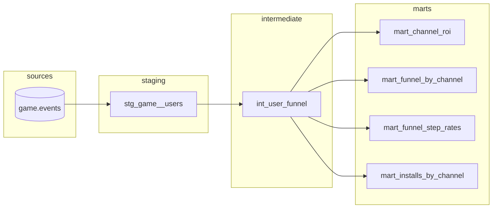
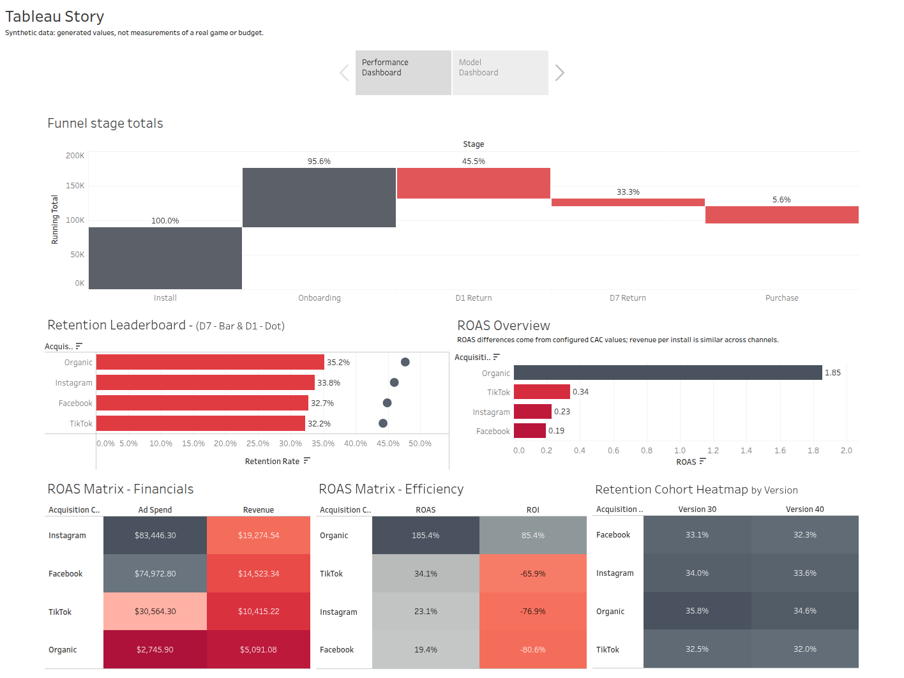
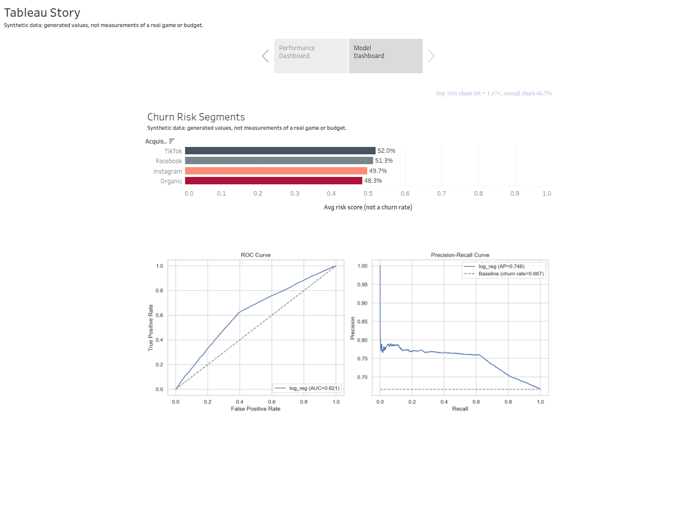

# Mobile Game Analytics Pipeline

<a target="_blank" href="https://cookiecutter-data-science.drivendata.org/">
    
</a>

[](https://github.com/umutdinceryananer/mobile-game-analytics-pipeline/actions/workflows/ci.yml)


## Executive Summary

This repository is a SQL and Python analytics pipeline run on synthetic data with known effects. It starts from the Cookie Cats player table, generates channel, retention, purchase and revenue fields from `data/config/synthetic.yaml`, and then builds funnel, retention and ROI/ROAS tables. Because the effects are set in the config, the outputs can be checked against them. Every figure in this README describes that synthetic data, not a real game or a real marketing budget.

### What this project demonstrates?

* Known-effect recovery: the retention channel effects set in the config are recovered from the pipeline output, checked by `tests/test_channel_effects.py`. The claim covers those retention effects only.
* Reproducible reporting: funnel, D1/D7 retention and ROI/ROAS by channel, built with externalized DuckDB SQL and Python and exported as tables and figures.
* Data checks: pytest coverage of the schema, distributions, the ROI formula and channel effects.

### Latest Metrics (synthetic data)

All values come from one `make pipeline` run on the synthetic build (seed 42). They reflect the generator's configuration and are not measurements of a real game.

* **Funnel (ratios of stage totals):** Install to Onboarding 95.6%, Onboarding to D1 47.6%, D1 to D7 73.2%, D7 to Purchase 16.8%. The stages are not nested cohorts: 39.3% of D7 returners have no D1 return.
* **Retention:** Overall D1 45.5%, D7 33.3%; Organic D1 47.7%, D7 35.2%. Among players who returned on D1, 44.4% also returned on D7 (Organic 45.5%).
* **ROI/ROAS:** Organic ROAS 1.85 (ROI +85%); paid channels range 0.19-0.34 ROAS (ROI -66% to -81%). These differences come entirely from the CAC values in the config; the generator has no channel effect on purchases or revenue.

### Data & Scope

* Dataset: one row per player, 90,189 rows, starting from [Cookie Cats (Kaggle)](https://www.kaggle.com/datasets/yufengsui/mobile-games-ab-testing). Only `userid`, `version` and the round count keep their original values. Every other column, including retention, is generated by `data/make_dataset.py` from `data/config/synthetic.yaml` (seed 42).
* KPIs: D1/D7 retention, funnel stage ratios, ROI/ROAS by channel, and a churn classifier on `retention_7`.

| Column | Origin | How it is built |
|---|---|---|
| `userid`, `version` | Cookie Cats | Unchanged |
| `session_count` | Cookie Cats | `sum_gamerounds`, renamed |
| `retention_1`, `retention_7` | Regenerated | The Cookie Cats values are overwritten by logistic draws using the config's channel and platform effects and `session_count`, plus `purchase` and `version` (D1) or `retention_1` and `revenue` (D7) |
| `acquisition_channel`, `country`, `platform` | Synthetic | Assigned from a hash of `userid` using config shares |
| `purchase` | Synthetic | Random draw whose probability rises with `session_count`; no channel effect |
| `CAC` | Synthetic | Fixed per channel in the config |
| `revenue` | Synthetic | Gamma-distributed purchase value for purchasers plus ad revenue from `session_count`, scaled by platform; no channel effect |
| `ROI` | Derived | `(revenue - CAC) / CAC` |

### Deliverables

#### Notebooks

* 0.9-SQL-Validation-and-Samples.ipynb
    * Runs the 4 SQL queries in `references/sql/` (installs by channel, funnel step rates, funnel by channel, ROI/ROAS) and compares the overlapping funnel columns against the Python output.

* 1.0-EDA-and-Funnel.ipynb
    * Defines the funnel stages (install, onboarding, D1, D7, purchase), produces the first KPI table and a funnel chart.

* 2.0-ROI-and-ROAS-by-Channel.ipynb
    * Computes ROI/ROAS by acquisition channel and exports ranked tables and a ROAS chart.

* 2.1-Retention-Cohorts.ipynb
    * D1/D7 retention by channel and by version, plus a D7 heatmap by version and channel.

* 3.0-Churn-Model.ipynb
    * Builds the churn feature set, trains LogReg & XGBoost, records ROC/PR metrics and top-decile lift, and exports channel/platform risk segments.

--------

## Usage & Reproducibility

This section explains **how to run the project end-to-end**, how SQL/Notebooks are wired, and where artifacts are exported. It is written to be **copy-paste runnable** on a fresh machine.

---

### Prerequisites

* Python **3.11+** (the pinned `numpy==2.3.3` does not install on 3.10)
* `pip` (or `pipx` if preferred)
* Git
* (Optional) **DuckDB** is installed via `requirements.txt` and used to run SQL over CSV/Parquet without a DB server.

---

### Quickstart

**Create and activate a virtual environment**

```bash
# macOS/Linux (on Debian/Ubuntu, install the python3-venv package first)
python3 -m venv .venv && source .venv/bin/activate

# Windows (PowerShell)
python -m venv .venv; .\.venv\Scripts\Activate.ps1
```

**Install Requirements**

```bash
# macOS/Linux
pip install -r requirements.txt

# Windows (PowerShell), also prints the welcome banner
./scripts/install.ps1
```

**Get the raw data**

The raw file is not part of this repository. Download `cookie_cats.csv` from [Mobile Games: A/B Testing on Kaggle](https://www.kaggle.com/datasets/yufengsui/mobile-games-ab-testing) and save it as `data/raw/cookie_cats.csv`. The numbers in this README need that file.

Without it, `make data` prints a warning and uses a fabricated file from `scripts/make_fabricated_raw_data.py`, so the pipeline still runs on a clean clone but its results will not match this README. Adding the real file later is enough: the next `make data` uses it. The direct `python -m` command below still needs the real file.

### Command-line Workflow

After installing requirements, you can reproduce the pipeline without opening notebooks:

1. `make data` - rebuilds `clean_data.csv` and `events.parquet` via the Typer CLI wrapper.
2. `make features` - creates `features.csv` and `labels.csv` with the churn flag.
3. `make analytics` - writes the funnel, ROI/ROAS and retention tables and figures to `reports/`.
4. `make train` - trains the churn models, writes metrics to `reports/tables/` and stores the best pipeline under `models/churn_model.pkl`.
5. `make dbt-build` - builds the dbt project in `dbt/` on DuckDB and runs its tests.
6. *(Optional)* `make predict` - uses the trained model to generate `predictions.csv` with churn probabilities.

Shortcut: `make pipeline` runs steps 1-5 sequentially.

Each rule calls `python -m mobile_game_analytics_pipeline.<command>` under the hood, so you can invoke them directly if you prefer finer control over paths.

If you don't have `make`, run the same steps directly:

```
# When Virtual Environment is Active
python -m mobile_game_analytics_pipeline.dataset
python -m mobile_game_analytics_pipeline.features
python -m mobile_game_analytics_pipeline.analytics
python -m mobile_game_analytics_pipeline.modeling.train
python -m mobile_game_analytics_pipeline.modeling.predict  # optional

# dbt must run from inside dbt/ because its paths are relative to that directory
cd dbt
dbt deps
dbt build
cd ..

```

### Project Layout (runnable paths)

```
mobile_game_analytics_pipeline/
├─ mobile_game_analytics_pipeline/
│  ├─ __init__.py
│  ├─ config.py
│  ├─ dataset.py               # Typer command: rebuild synthetic data
│  ├─ features.py              # Typer command: create features & labels
│  ├─ analytics.py             # Typer command: funnel, ROI/ROAS, retention tables
│  ├─ modeling/
│  │  ├─ __init__.py
│  │  ├─ train.py              # Typer command: train churn model
│  │  └─ predict.py            # Typer command: generate predictions
│  └─ …
├─ data/
│  ├─ raw/
│  │  └─ cookie_cats.csv
│  ├─ processed/               # clean_data.csv, events.parquet, features.csv, labels.csv
│  ├─ warehouse/               # analytics.duckdb, built by dbt
│  ├─ config/
│  │  └─ synthetic.yaml
│  └─ make_dataset.py
├─ notebooks/
│  ├─ 0.9-SQL-Validation-and-Samples.ipynb
│  ├─ 1.0-EDA-and-Funnel.ipynb
│  ├─ 2.0-ROI-and-ROAS-by-Channel.ipynb
│  ├─ 2.1-Retention-Cohorts.ipynb
│  └─ 3.0-Churn-Model.ipynb
├─ dbt/
│  ├─ dbt_project.yml
│  ├─ profiles.yml
│  ├─ packages.yml
│  ├─ models/
│  │  ├─ docs.md               # metric definitions used by model descriptions
│  │  ├─ staging/
│  │  ├─ intermediate/
│  │  └─ marts/
│  └─ tests/                   # singular tests
├─ scripts/
│  ├─ dbt_lineage_mermaid.py   # writes the README lineage diagram
│  └─ make_fabricated_raw_data.py  # used when the Kaggle file is missing
├─ references/
│  └─ sql/
├─ reports/
│  ├─ tables/
│  ├─ figures/
│  └─ executive_summary.md
├─ tests/
│  ├─ test_channel_effects.py
│  ├─ test_dbt_parity.py
│  └─ test_synthetic.py
├─ Makefile
├─ requirements.txt
└─ README.md
```

---

### Data Inputs

* Primary input: `data/processed/clean_data.csv` (or `data/processed/events.parquet`).
* Notebook 0.9 (SQL) reads `clean_data.csv` and **creates the DuckDB views `users` and `events`**.
* If neither file is present, notebooks will raise a clear error.

---

### Running Order

Run notebooks **top-down** in this order:

1. **`0.9-SQL-Validation-and-Samples.ipynb`**
   Loads SQL from `references/sql/` and executes via DuckDB. Exports validation tables to `reports/tables/`.

2. **`1.0-EDA-and-Funnel.ipynb`**
   Defines the funnel and exports `funnel.csv` and `funnel.png`.

3. **`2.0-ROI-and-ROAS-by-Channel.ipynb`**
   Computes ROI/ROAS by channel; exports `roi_by_channel.csv` and `roi_by_channel.png`.

4. **`2.1-Retention-Cohorts.ipynb`**
   Produces D1/D7 retention tables and a D7 heatmap; exports `retention_by_channel.csv` and `retention_heatmap.png`.

5. **`3.0-Churn-Model.ipynb`**
   Churn classification (LogReg + XGBoost). Exports `model_metrics.json` and one key figure (`roc_pr_curves.png`).

---

### SQL Usage (Externalized & Reused)

SQL is stored in **`references/sql/`** and loaded from notebook 0.9 at runtime. The dbt marts reproduce these queries; see dbt Layer.

* `references/sql/installs_by_channel.sql`
* `references/sql/funnel_step_rates.sql`
* `references/sql/funnel_by_channel.sql`
* `references/sql/roi_by_channel.sql`

---

### Exports (Artifacts)

All notebooks **export tables and figures** to a consistent location:

* **Tables:** `reports/tables/`
  * `funnel.csv`, `funnel_long.csv`, `roi_by_channel.csv`, `roi_by_channel_long.csv`, `retention_by_channel.csv`, `retention_cohort_by_version.csv`

* **Figures:** `reports/figures/`
  * `funnel.png`, `roi_by_channel.png`, `retention_heatmap.png`, `roc_pr_curves.png`

* **Summary:** `reports/executive_summary.md` (curated manually from notebook findings)

---

### Data Quality Checks & Testing

Run these after `make pipeline`; the tests read its outputs.

```bash
pytest -q
```

* `tests/test_synthetic.py` validates the schema, allowed channel values, country and platform distributions, platform revenue shares, and the ROI formula for the synthetic dataset.
* `tests/test_channel_effects.py` fits the generator's logistic form on `events.parquet` and checks that the retention channel effects set in the config are recovered within 3 standard errors, with a shuffled-label negative control. It also runs `analytics.py` and checks that Organic retention is above TikTok and that spend per user equals the config CAC.
* `tests/test_dbt_parity.py` runs each query in `references/sql/` and compares the result row by row with the matching dbt mart.
* CLI smoke test: `make pipeline` (or run the Typer commands manually) regenerates data, features, and churn model artefacts end-to-end.

#### Enabling Pre-commit Hooks

This repository uses `pre-commit` hooks (formatting, lint checks, etc.). A fresh clone does not include the hook automatically; run the following once after setting up your environment:

```bash
pre-commit install
```

---

### Reproducibility Notes

* **Determinism:** set seeds for model training and sampling (e.g., `numpy`, `random`, model libraries).
* **Train/test split:** `mobile_game_analytics_pipeline/modeling/train.py` uses a random stratified 70/30 holdout (`train_test_split(..., stratify=y)`) and shuffled 5-fold `StratifiedKFold` on the training portion. `backtest_scores.csv` holds those cross-validation folds, not a temporal backtest.
* **Recommendation for real data:** this dataset has no timestamp column, so a time-based split is not possible here. On real event data, validate with a time-based holdout instead.
* **Versioning:** tag releases when major deliverables change (e.g., `v0.1` MVP, `v0.2` cohorts deep dive, `v0.3` modeling).
* **Environment:** keep `requirements.txt` up to date; pin critical libs if needed for a clean re-run.

---

## dbt Layer

The four KPI queries in `references/sql/` are also built as a dbt project on DuckDB, in `dbt/`. The marts are the definition of these metrics. `references/sql/` stays so that `tests/test_dbt_parity.py` can prove the marts return the same values, and notebook 0.9 still reads it. `analytics.py` and the notebooks produce the CSV and PNG exports separately from dbt.

### Run from a clean clone

```bash
git clone https://github.com/umutdinceryananer/mobile-game-analytics-pipeline.git
cd mobile-game-analytics-pipeline
python3 -m venv .venv && source .venv/bin/activate
pip install -r requirements.txt

# Optional: save the Kaggle download as data/raw/cookie_cats.csv to get this README's numbers.
# Without it, make data prints a warning and uses fabricated data.
make pipeline      # data, features, analytics, train, dbt build
pytest -q          # reads the outputs of make pipeline
make dbt-docs      # opens the interactive documentation and lineage
```

`make dbt-lineage` regenerates the diagram below. To run dbt by hand, run it from inside `dbt/`, because its paths are relative to that directory.

### Lineage

<!-- dbt-lineage:start -->

<!-- dbt-lineage:end -->

### How `roas` in `mart_channel_roi` is built

Reading backwards from the mart column to the source columns:

**1. `dbt/models/marts/mart_channel_roi.sql`** computes the ratio from channel totals.

```sql
case when ad_spend > 0 then revenue / ad_spend end as roas
```

The totals come from an earlier step in the same model, grouped by `acquisition_channel`.

```sql
sum(revenue) as revenue,
sum(ad_spend) as ad_spend
```

**2. `dbt/models/intermediate/int_user_funnel.sql`** holds one row per player and names the cost `ad_spend`.

```sql
coalesce(revenue, 0.0) as revenue,
coalesce(cac, 0.0) as ad_spend
```

**3. `dbt/models/staging/stg_game__users.sql`** only casts the source columns. DuckDB identifiers are case-insensitive, so `cac` reads the `CAC` column.

```sql
cast(cac as double) as cac,
cast(revenue as double) as revenue,
```

**4. Source `game.events`** is `data/processed/events.parquet`, written by `make data`. `CAC` is a fixed value per channel in `data/config/synthetic.yaml`, and `revenue` is generated per player with no channel effect, so ROAS differences across channels come from the configured CAC.

`revenue_per_install` in the same mart divides the same `revenue` total by `users`. It ranges from 0.53 to 0.58 across channels while spend per user ranges from 0.30 to 2.80, which shows that split directly.

### Tests

`make dbt-build` runs every row below except the last one, which runs under `pytest -q`.

| Test | Count | What it protects |
|---|---|---|
| `not_null` | 35 | No missing keys, flags, amounts or mart metrics |
| `unique` | 5 | One row per player in staging and intermediate, one row per channel in the channel marts |
| `accepted_values` | 8 | Known channel, country, platform and version labels; funnel flags stay 0 or 1 |
| `dbt_utils.accepted_range` | 4 | Session count, CAC and revenue are not negative; ROI is not below -1 |
| `assert_funnel_steps_do_not_increase` | 1 | Stage totals never rise from one step to the next, overall and per channel |
| `assert_rates_between_zero_and_one` | 1 | Every `rate_*` column of the funnel marts stays between 0 and 1 |
| `assert_channel_roi_formulas` | 1 | ROAS, ROI and revenue per install match their formulas |
| `assert_channel_installs_match_staging` | 1 | Channel install counts add up to the distinct players in staging |
| `tests/test_dbt_parity.py` | 4 | Each mart matches its reference SQL row by row |

CI (`.github/workflows/ci.yml`) runs `make data`, `make dbt-build` and `pytest -q` on every push and pull request. The Cookie Cats file is not in this repository, so `make data` falls back to a fabricated raw file from `scripts/make_fabricated_raw_data.py` there. A green badge means the pipeline and tests work. It does not validate the numbers in this README, which come from a local run on the real file.

---

## Results on Synthetic Data

This section compares what the config sets with what the SQL and Python layers report back, embeds exported figures, and lists limitations. Nothing here is evidence about a real game or a real budget.

---

### Results Overview (Key Findings)

**Funnel**

| Stage | Users | Share of installs | Ratio to previous stage |
|---|---|---|---|
| Install | 90,189 | 100.0% | |
| Onboarding (`session_count` > 0) | 86,195 | 95.6% | 95.6% |
| D1 return | 41,024 | 45.5% | 47.6% |
| D7 return | 30,028 | 33.3% | 73.2% |
| Purchase | 5,030 | 5.6% | 16.8% |

These are ratios of stage totals, not conversion rates, because the generated flags are not nested: 11,798 D7 returners (39.3%) have no D1 return, 1,849 of the 5,030 purchasers have no D1 return, and 1,220 D1 returners have `session_count` = 0.

**ROI/ROAS by Channel: set by the config**

ROAS differences across channels come entirely from the CAC values set in the config. The generator has no channel term in purchases or revenue, so the small differences in revenue per user below are sampling noise. The ROAS ranking restates the CAC inputs and is not a finding about the channels.

| Channel | Config CAC | Purchase rate | Revenue per user | ROAS | ROI |
|---|---|---|---|---|---|
| Organic | 0.30 | 5.5% | 0.556 | 1.85 | +85% |
| TikTok | 1.70 | 5.5% | 0.579 | 0.34 | -66% |
| Instagram | 2.30 | 5.6% | 0.531 | 0.23 | -77% |
| Facebook | 2.80 | 5.6% | 0.542 | 0.19 | -81% |

**Retention by Channel: recovered from the output**

`tests/test_channel_effects.py` fits the generator's logistic form on `events.parquet` and compares the channel effects with the config. Values are logit effects relative to Organic.

| Channel vs Organic | D1 config | D1 fitted | D7 config | D7 fitted |
|---|---|---|---|---|
| Instagram | -0.08 | -0.069 | -0.06 | -0.050 |
| Facebook | -0.14 | -0.110 | -0.11 | -0.089 |
| TikTok | -0.16 | -0.138 | -0.13 | -0.105 |

All six fitted effects are within 3 standard errors of the config (standard errors 0.024 to 0.028). Direction is tested only where the config value is at least 3 standard errors from zero, which leaves out D7 Instagram. This recovery claim covers these retention channel effects only.

| Channel | D1 rate | D7 rate | D7 among D1 returners |
|---|---|---|---|
| Organic | 47.7% | 35.2% | 45.5% |
| Instagram | 46.0% | 33.8% | 44.9% |
| Facebook | 44.9% | 32.7% | 43.9% |
| TikTok | 44.3% | 32.2% | 43.7% |

Overall, `45.5%` of installs return on D1 and `33.3%` on D7. Among players who returned on D1, `44.4%` also returned on D7, against `24.0%` of players who did not return on D1. The `d7_from_d1` column in `retention_by_channel.csv` (`73.8%` for `Organic`) is a ratio of two totals, not this conditional rate.

---

### Churn Model (Secondary, With Limits)

A compact classifier on the synthetic data, kept as a modelling exercise. It is not part of the recovery claim above. The label is `churn_flag`, the inverse of `retention_7`. `make train` fits both models and stores the one with the higher test ROC-AUC. Scores are from a stratified 30% holdout (27,057 players, seed 42).

| Model | ROC-AUC | PR-AUC | Accuracy | Churn rate in riskiest 10% | Lift | Share of churners in riskiest 10% |
|---|---|---|---|---|---|---|
| XGBoost (stored in this run) | 0.622 | 0.744 | 0.665 | 76.8% | 1.15x | 11.5% |
| Logistic regression | 0.621 | 0.746 | 0.615 | 78.3% | 1.17x | 11.7% |

For the stored XGBoost model, the churn rate is 66.7% overall and 76.8% in the riskiest 10% of players (lift 1.15x), and that 10% contains 11.5% of all churners.

* The two models differ by less than 0.001 in ROC-AUC, so which one gets stored is close to arbitrary.
* Always predicting churn scores 0.667 accuracy, so neither model beats that baseline on accuracy.
* The features overlap the D7 label window and the scores are not calibrated (see Limitations & Assumptions).
* These scores are measured on synthetic data and say nothing about performance on real data.

*Artifacts:* `make train` writes `reports/tables/backtest_scores.csv`, `reports/tables/model_metrics.json` and `reports/figures/roc_pr_curves.png`. `reports/tables/churn_risk_segments.csv` is written only by notebook 3.0 and `_run_churn.py`.

---

### Visuals (Exported Artifacts)

* **Funnel**
  

* **D7 Retention Heatmap (version by channel)**
  

* **Churn model ROC/PR (logistic regression, from an earlier run)**
  

---

### Dashboard (Tableau)
* [**Tableau Link**](https://public.tableau.com/views/MobileGameUAStory/TableauStory?:language=en-US&:sid=&:redirect=auth&:display_count=n&:origin=viz_share_link)

Built from an earlier run on the same synthetic data. The model dashboard shows logistic regression, and its risk values are uncalibrated model scores, not churn rates, even though the bar labels are formatted as percentages. The funnel chart stacks stages on a running-total axis, so read its percentage labels rather than its bar heights; the funnel table in Results has the stage totals.




### Limitations & Assumptions

* **Synthetic data:** Retention, purchases, revenue, CAC, channel, country and platform are all generated (see Data & Scope). Only `userid`, `version` and the round count are original Cookie Cats values, so no metric here describes a real game or real channel performance.
* **Schema/coverage:** The data has one row per player and no timestamps, so time trends and time-based validation are not possible.
* **No attribution model:** Each player gets one channel from a hash of `userid`, so channel results say nothing about attribution.
* **Model scope:** The churn classifiers are compact prototypes with no hyperparameter search. Predicted probabilities are not calibrated: the logistic model uses `class_weight="balanced"`, so its scores work as a ranking rather than as churn probabilities.
* **Label-window leakage:** `session_count` is the Cookie Cats column `sum_gamerounds`, which the dataset description defines as "the number of game rounds played by the player during the first 14 days after install". That window overlaps the D7 retention label, and the churn model uses `session_count` as a feature, along with `revenue` and `ROI`, which are derived from it. Its scores therefore include behaviour from after the day the label refers to. In this synthetic build `retention_7` is also generated directly from `session_count`. The model is unchanged, so read its metrics with this leak in mind.

---

### License & Credits

* Code is released under **MIT License** (see `LICENSE`).
* Dataset: Cookie Cats (Kaggle), used here for educational/demo purposes with generated channel, retention, purchase and revenue fields.

---
